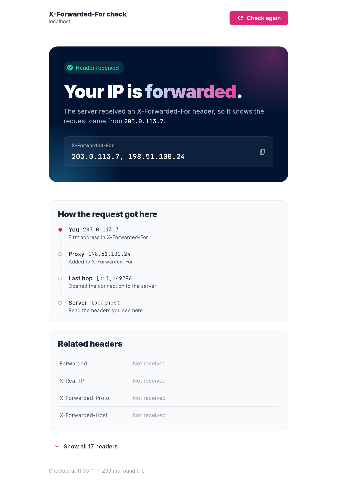

# X-Forwarded-For check

A tiny [Serverpod](https://serverpod.dev) + Flutter app that answers one question:

> **When my server runs behind a proxy, does it still learn the client's real IP address?**

The server "bounces" every request it receives back to the caller, reporting the `X-Forwarded-For` header, related forwarding headers, the address of the machine that opened the TCP connection, and every other header. The Flutter app shows the result in plain language.

<p align="center">
  
</p>

**Live demo on Serverpod Cloud:** https://x-forwarded-test.serverpod.space ([raw JSON](https://x-forwarded-test.serverpod.space/echo))

## What it shows

- **The answer:** whether `X-Forwarded-For` reached the server, and the IP it reports for you.
- **How the request got here:** each address in the chain: you → proxies → the last hop that connected to the server → the server.
- **Related headers:** `Forwarded`, `X-Real-IP`, `X-Forwarded-Proto` and `X-Forwarded-Host`, or "Not received".
- **All headers:** everything the server received. Tap a row to copy it.

## Try it with curl

```sh
curl https://x-forwarded-test.serverpod.space/echo
```

```json
{
  "xForwardedFor": "203.0.113.7, 198.51.100.24",
  "remoteAddress": "[::ffff:10.0.0.5]:35398",
  "headers": { "x-forwarded-for": "203.0.113.7, 198.51.100.24", "...": "..." }
}
```

Send your own header to see how the proxy treats it:

```sh
curl -H 'X-Forwarded-For: 1.2.3.4' https://x-forwarded-test.serverpod.space/echo
```

## How it works

```
x_forwarded_test_server/   Serverpod backend
  lib/src/echo/
    request_echo.spy.yaml      RequestEcho model (what the server saw)
    request_echo_builder.dart  Reads headers + peer address from the request
    echo_endpoint.dart         RPC endpoint: client.echo.bounce()
    echo_route.dart            Plain HTTP route: GET /echo → JSON
x_forwarded_test_flutter/  Flutter app (web, mobile, desktop)
  lib/screens/echo_screen.dart  The UI
  lib/app_theme.dart            Colours and fonts
x_forwarded_test_client/   Generated client code (don't edit)
```

The RPC endpoint and the `/echo` route share the same builder. They're served on different domains on Serverpod Cloud (`*.api.serverpod.space` and `*.serverpod.space`), so you can check both paths.

## Run it locally

Requires the [Flutter SDK](https://docs.flutter.dev/get-started/install) and the Serverpod CLI (`dart pub global activate serverpod_cli`).

```sh
cd x_forwarded_test_server
serverpod start
```

This starts the server and the Flutter app and hot-reloads both on changes. The local server has no proxy in front of it, so the app will report the header as missing unless you add one:

```sh
curl -H 'X-Forwarded-For: 1.2.3.4' http://localhost:8082/echo
```

Run the server tests with `dart test` in `x_forwarded_test_server`.

## Deploy your own copy to Serverpod Cloud

```sh
cd x_forwarded_test_server
serverpod cloud launch      # create a project (pick your own ID) and deploy it
serverpod cloud deploy      # deploy later changes
```

See the [Serverpod Cloud docs](https://docs.serverpod.dev/cloud) for details.
